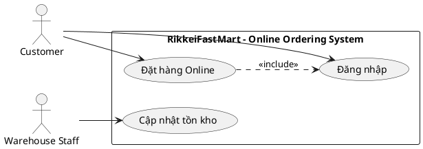
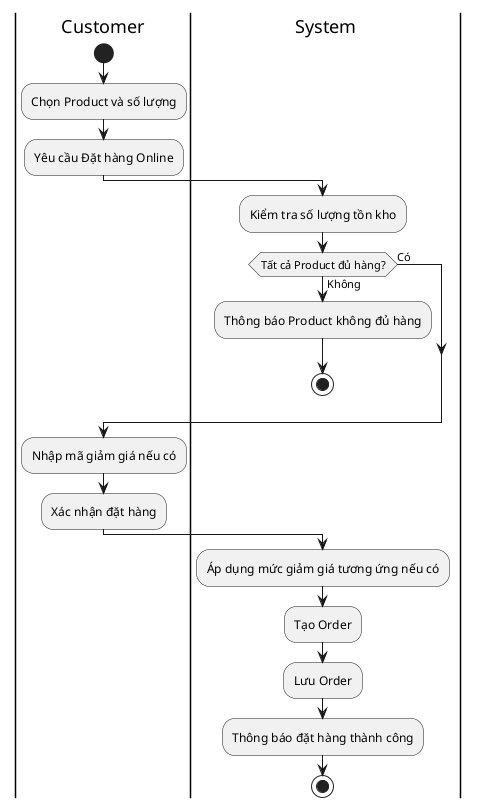
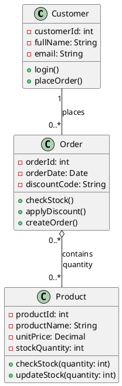
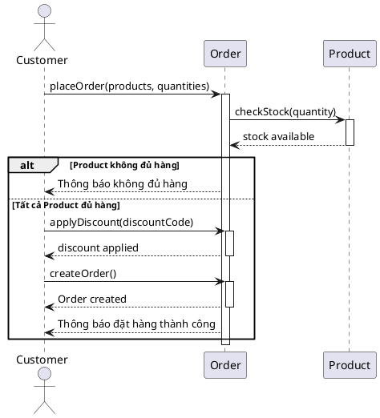

Có một điểm kỹ thuật đáng chú ý: đề bắt **3 Class**, nhưng nghiệp vụ lại có quan hệ **N–N giữa Order và Product + số lượng mua riêng**. Vì vậy ở Class Diagram ta giữ đúng 3 Class và biểu diễn `quantity` trên quan hệ; khi xuống ERD bắt buộc phải sinh bảng trung gian `ORDER_ITEM`. Đây là cách xử lý đúng về mặt mô hình dữ liệu.

# MINI PROJECT: PHÂN TÍCH THIẾT KẾ LUỒNG ĐẶT HÀNG ONLINE – RIKKEIFASTMART

## 1. Bước 1 — Yêu cầu FR/NFR

| Mã         | Loại          | Nội dung                                                                                                                                                                                              |
| ---------- | ------------- | ----------------------------------------------------------------------------------------------------------------------------------------------------------------------------------------------------- |
| **FR-01**  | Chức năng     | Hệ thống phải cho phép **Customer** xem sản phẩm, chọn số lượng và thêm sản phẩm vào giỏ hàng để thực hiện **Đặt hàng Online**.                                                                       |
| **FR-02**  | Chức năng     | Hệ thống phải kiểm tra số lượng tồn kho của tất cả sản phẩm trong giỏ; nếu đủ hàng thì áp dụng mã giảm giá nếu có và tạo **Order**, nếu thiếu hàng thì thông báo cho **Customer** và không tạo Order. |
| **NFR-01** | Phi chức năng | Hệ thống phải trả kết quả kiểm tra tồn kho của toàn bộ sản phẩm trong giỏ trong **không quá 2 giây đối với ít nhất 95% yêu cầu**, trong điều kiện tối đa **100 người dùng đồng thời**.                |

### Giải thích

FR-01 mô tả phần người dùng thực hiện trước khi đặt hàng.

FR-02 mô tả phần xử lý nghiệp vụ quan trọng nhất: kiểm tra tồn kho → mã giảm giá → tạo đơn.

NFR-01 được viết bằng số liệu nên Dev và Tester có thể kiểm thử được. Không dùng kiểu:

> "Hệ thống phải kiểm tra tồn kho nhanh."

Vì **"nhanh" không có tiêu chuẩn đo lường**.

---

# 2. Bước 2 — Kiến trúc 3 tầng

| Tầng                    | Vai trò trong luồng Đặt hàng Online                                                                                                                                                         |
| ----------------------- | ------------------------------------------------------------------------------------------------------------------------------------------------------------------------------------------- |
| **Presentation Tier**   | Nhận thao tác từ Customer như đăng nhập, xem sản phẩm, chọn số lượng, nhập mã giảm giá và xác nhận đặt hàng; hiển thị kết quả kiểm tra tồn kho hoặc thông báo đặt hàng thành công/thất bại. |
| **Business Logic Tier** | Xử lý nghiệp vụ Đặt hàng Online: kiểm tra tồn kho, xác định mã giảm giá, kiểm tra điều kiện đặt hàng và tạo Order.                                                                          |
| **Data Tier**           | Đọc/ghi dữ liệu Customer, Product, Order và dữ liệu chi tiết sản phẩm trong Order; cập nhật số lượng tồn kho khi có nhập hàng.                                                              |

Luồng tổng quát:

```text
Customer
   ↓
Presentation Tier
   ↓
Business Logic Tier
   ↓
Data Tier
   ↓
Database
```

---

# 3. Bước 3 — Use Case Diagram

## 3.1. Actor

Chỉ sử dụng đúng 2 Actor:

### Actor 1 — Customer

Khách hàng sử dụng app để đăng nhập, mua sản phẩm và đặt hàng.

### Actor 2 — Warehouse Staff

Nhân viên kho cập nhật số lượng tồn kho khi cửa hàng nhập hàng mới.

---

## 3.2. Use Case

Để không vượt quá giới hạn 3–4 Use Case, chọn đúng 3 Use Case:

1. **Đăng nhập**
2. **Đặt hàng Online**
3. **Cập nhật tồn kho**

Trong đó:

* `Đặt hàng Online` là Use Case chính.
* `Đặt hàng Online` `<<include>>` `Đăng nhập` vì khách hàng bắt buộc phải đăng nhập trước khi mua.
* `Warehouse Staff` thực hiện `Cập nhật tồn kho`.

### Quan hệ

```text
Customer ─────────────── Đăng nhập
   │
   └──────────────────── Đặt hàng Online
                              │
                              └── <<include>> ── Đăng nhập

Warehouse Staff ─────── Cập nhật tồn kho
```

## 3.3. Mã PlantUML để vẽ Use Case



### Lưu ý

Không thêm:

* Thanh toán
* Giao hàng
* Hủy đơn
* Theo dõi đơn
* Đánh giá sản phẩm

vì **đề không có**.

---

# 4. Bước 4 — Đặc tả Use Case & Activity Diagram

## 4.1. Đặc tả Use Case

### Use Case Name & ID

**UC-02 — Đặt hàng Online**

### Actor(s) & Description

**Actor chính:** Customer

Customer sử dụng ứng dụng để chọn sản phẩm, nhập số lượng, kiểm tra tồn kho, nhập mã giảm giá nếu có và xác nhận đặt hàng.

### Pre-conditions

1. Customer đã có tài khoản.
2. Customer đã đăng nhập.
3. Product cần mua đang tồn tại trong hệ thống.
4. Customer đã chọn ít nhất một Product để đặt hàng.

### Post-conditions

**Trường hợp thành công:**

* Một Order mới được tạo.
* Order được gắn với Customer.
* Các Product và số lượng mua được lưu trong Order.
* Mã giảm giá đã sử dụng được lưu nếu Customer nhập mã.
* Hệ thống thông báo đặt hàng thành công.

**Trường hợp thất bại:**

* Không tạo Order nếu có ít nhất một Product không đủ tồn kho.
* Hệ thống thông báo Product không đủ hàng.

---

## 4.2. Main Flow

Giữ đúng **6 bước**, nằm trong giới hạn đề yêu cầu:

| Bước  | Actor/System | Nội dung                                                                    |
| ----- | ------------ | --------------------------------------------------------------------------- |
| **1** | Customer     | Customer chọn Product và số lượng muốn mua, sau đó yêu cầu Đặt hàng Online. |
| **2** | System       | Hệ thống kiểm tra số lượng tồn kho của từng Product trong giỏ hàng.         |
| **3** | System       | Hệ thống xác nhận tất cả Product đều đủ số lượng tồn kho.                   |
| **4** | Customer     | Customer nhập mã giảm giá nếu có và xác nhận đặt hàng.                      |
| **5** | System       | Hệ thống áp dụng mức giảm giá tương ứng nếu có mã hợp lệ và tạo Order.      |
| **6** | System       | Hệ thống lưu Order và thông báo đặt hàng thành công cho Customer.           |

---

## 4.3. Alternative Flows

### AF-01 — Sản phẩm không đủ tồn kho

Xảy ra tại **Bước 3**:

```text
3a. Nếu có ít nhất một Product không đủ số lượng:
    - System thông báo Product không đủ hàng.
    - System không tạo Order.
    - Use Case kết thúc.
```

### AF-02 — Customer không nhập mã giảm giá

Xảy ra tại **Bước 4**:

```text
4a. Customer không nhập mã giảm giá.
4b. System bỏ qua việc áp dụng giảm giá.
4c. Tiếp tục Bước 5.
```

---

# 5. Activity Diagram

## 5.1. Swimlane

Chỉ cần 2 swimlane:

```text
Customer | System
```

Warehouse Staff không tham gia luồng đặt hàng nên **không được nhét vào Activity Diagram này**.

## 5.2. Luồng

```text
Customer                         System
   |                               |
   |-- Chọn Product + số lượng --->|
   |                               |
   |                         Kiểm tra tồn kho
   |                               |
   |                         [Đủ hàng?]
   |                         /          \
   |                       Không         Có
   |                        |             |
   |                  Thông báo          |
   |                  không đủ hàng      |
   |                        |             |
   |                       END       Nhập mã giảm giá
   |                                      |
   |                              Xác nhận đặt hàng
   |                                      |
   |                              Áp dụng giảm giá
   |                                      |
   |                                  Tạo Order
   |                                      |
   |                              Lưu Order
   |                                      |
   |                         Thông báo thành công
   |                                      |
   |                                     END
```

## 5.3. PlantUML Activity Diagram



---

# 6. Bước 5 — Class Diagram

Từ Main Flow, danh từ chính:

* Customer
* Product
* Order
* mã giảm giá
* số lượng

Theo giới hạn đề bài chỉ được **3 Class**, vì vậy chọn:

1. `Customer`
2. `Order`
3. `Product`

---

## 6.1. Class

| Class        | Thuộc tính                                                                                  | Phương thức                                                   |
| ------------ | ------------------------------------------------------------------------------------------- | ------------------------------------------------------------- |
| **Customer** | `- customerId: int`  `- fullName: String`  `- email: String`                                | `+ login()`  `+ placeOrder()`                                 |
| **Order**    | `- orderId: int`  `- orderDate: Date`  `- discountCode: String`                             | `+ checkStock()`  `+ applyDiscount()`  `+ createOrder()`      |
| **Product**  | `- productId: int`  `- productName: String`  `- unitPrice: Decimal`  `- stockQuantity: int` | `+ checkStock(quantity: int)`  `+ updateStock(quantity: int)` |

---

## 6.2. Quan hệ giữa các Class

### Customer — Order

```text
Customer 1 ─────────── 0..* Order
```

Một Customer có thể có nhiều Order.

Một Order chỉ thuộc về một Customer.

---

### Order — Product

```text
Order 0..* ─────────── 0..* Product
             quantity
```

Đây là quan hệ **N–N**.

Một Order có nhiều Product.

Một Product có thể xuất hiện trong nhiều Order.

`quantity` nằm trên quan hệ vì:

> Số lượng mua không phải thuộc tính của Product và cũng không phải thuộc tính cố định của Order.

Ví dụ:

```text
Product A
stockQuantity = 100
```

Không thể ghi:

```text
Product.quantity = 3
```

vì hôm nay Customer A mua 3 sản phẩm, ngày mai Customer B có thể mua 10 sản phẩm.

`quantity` phải gắn với **Order + Product**.

---

## 6.3. Class Diagram PlantUML



### Vì sao chọn Aggregation?

Quan hệ:

```text
Order o-- Product
```

được dùng dưới dạng **Aggregation** vì Product tồn tại độc lập với Order.

Ví dụ:

```text
Order #1001 bị xóa
        ↓
Product Coca Cola vẫn tồn tại
```

Đề bài nói rất rõ:

> Sản phẩm tồn tại độc lập với các đơn hàng.

Do đó **không được dùng Composition giữa Order và Product**.

---

# 7. Bước 6 — Sequence Diagram

Sequence Diagram phải bám đúng Main Flow.

Lifeline:

```text
Customer
Order
Product
```

Trong giới hạn 3 Class, không tạo thêm:

```text
OrderService
ProductRepository
Database
```

vì sẽ làm lệch yêu cầu "Lifeline gồm Actor chính và các đối tượng thuộc Class ở Bước 5".

## 7.1. Luồng

```text
Customer
   |
   | Chọn Product + quantity
   v
Order
   |
   | checkStock()
   v
Product
   |
   | stock result
   v
Order
   |
   | đủ hàng
   |
   | Customer nhập discountCode
   |
   | applyDiscount()
   |
   | createOrder()
   |
   | order created
   v
Customer
```

## 7.2. PlantUML Sequence Diagram



---

# 8. Bước 7 — UI Wireframe

Chọn màn hình **Xác nhận Đặt hàng Online** vì màn hình này xuất hiện trực tiếp trong Main Flow và chứa nhiều thao tác quan trọng.

## 8.1. Wireframe

```text
┌─────────────────────────────────────────────────────┐
│                  RikkeiFastMart                     │
├─────────────────────────────────────────────────────┤
│                 XÁC NHẬN ĐẶT HÀNG                   │
├─────────────────────────────────────────────────────┤
│ Sản phẩm                                             │
│                                                     │
│ Coca Cola       SL: [ 2 ]       20.000đ             │
│ Bánh Oreo       SL: [ 1 ]       15.000đ             │
│                                                     │
├─────────────────────────────────────────────────────┤
│ Mã giảm giá                                         │
│                                                     │
│ [ Nhập mã giảm giá                     ] [Áp dụng] │
│                                                     │
├─────────────────────────────────────────────────────┤
│ Tạm tính:                              55.000đ      │
│ Giảm giá:                               5.000đ      │
│ Tổng cộng:                              50.000đ      │
│                                                     │
│                 [ XÁC NHẬN ĐẶT HÀNG ]              │
└─────────────────────────────────────────────────────┘
```

## 8.2. Đối chiếu UI với Main Flow

| Thành phần UI                | Main Flow |
| ---------------------------- | --------- |
| Danh sách Product + số lượng | Bước 1    |
| Ô nhập mã giảm giá           | Bước 4    |
| Nút `Áp dụng`                | Bước 5    |
| Nút `XÁC NHẬN ĐẶT HÀNG`      | Bước 4    |
| Tổng tiền sau giảm           | Bước 5    |
| Thông báo thành công         | Bước 6    |

Tối thiểu 3 thành phần UI đã có:

* Input
* Button
* Product list
* Quantity control
* Thông tin tổng tiền

---

# 9. Bước 8 — ERD

Đây là chỗ cần đặc biệt chú ý.

## 9.1. Ánh xạ Class → Entity

Ba Class ở Bước 5:

```text
Customer
Order
Product
```

được ánh xạ thành ba Entity chính.

Tuy nhiên:

```text
Order N ───── N Product
```

là quan hệ N–N.

Trong quan hệ này lại có:

```text
quantity
```

nên khi chuyển sang cơ sở dữ liệu quan hệ, **bắt buộc phải có bảng trung gian**.

Bảng này là:

```text
ORDER_ITEM
```

Đây không phải Class thứ 4 trong Class Diagram; nó là bảng kỹ thuật cần thiết để triển khai quan hệ N–N trong database.

---

## 9.2. Các bảng

| Bảng           | Cột                                                                    |
| -------------- | ---------------------------------------------------------------------- |
| **CUSTOMER**   | `customer_id` **PK**, `full_name`, `email`                             |
| **ORDER**      | `order_id` **PK**, `customer_id` **FK**, `order_date`, `discount_code` |
| **PRODUCT**    | `product_id` **PK**, `product_name`, `unit_price`, `stock_quantity`    |
| **ORDER_ITEM** | `order_id` **PK, FK**, `product_id` **PK, FK**, `quantity`             |

### ORDER_ITEM

Khóa chính kép:

```text
(order_id, product_id)
```

Ví dụ:

```text
ORDER_ITEM

order_id | product_id | quantity
---------|------------|---------
1001     | 10         | 2
1001     | 20         | 1
1002     | 10         | 5
```

Nhìn vào đây là thấy ngay tại sao `quantity` phải nằm trong `ORDER_ITEM`.

---

# 9.3. ERD

```text
┌──────────────────────┐
│       CUSTOMER       │
├──────────────────────┤
│ PK customer_id       │
│    full_name         │
│    email             │
└──────────┬───────────┘
           │
           │ 1
           │
           │ 0..*
┌──────────▼───────────┐
│        ORDER         │
├──────────────────────┤
│ PK order_id          │
│ FK customer_id       │
│    order_date        │
│    discount_code     │
└──────────┬───────────┘
           │
           │ 1
           │
           │ 0..*
┌──────────▼───────────┐
│      ORDER_ITEM      │
├──────────────────────┤
│ PK,FK order_id       │
│ PK,FK product_id     │
│     quantity         │
└──────────┬───────────┘
           │
           │ 0..*
           │
           │ 1
┌──────────▼───────────┐
│       PRODUCT        │
├──────────────────────┤
│ PK product_id        │
│    product_name      │
│    unit_price        │
│    stock_quantity    │
└──────────────────────┘
```

Quan hệ thực tế:

```text
CUSTOMER 1 ─── N ORDER
ORDER    1 ─── N ORDER_ITEM
PRODUCT  1 ─── N ORDER_ITEM
```

Suy ra:

```text
ORDER N ─── N PRODUCT
```

thông qua:

```text
ORDER_ITEM
```

---

# 9.4. Vì sao đạt 3NF?

Thiết kế đạt **3NF** vì mỗi bảng lưu dữ liệu của một đối tượng hoặc một quan hệ cụ thể, các thuộc tính không khóa phụ thuộc trực tiếp vào khóa chính của bảng và không có thuộc tính không khóa phụ thuộc bắc cầu vào khóa chính.

Ví dụ:

```text
PRODUCT
product_id → product_name, unit_price, stock_quantity
```

và:

```text
ORDER_ITEM
(order_id, product_id) → quantity
```

Do đó không lặp thông tin Product trong từng Order và không lặp thông tin Customer trong từng Product.

---

# 10. Bước 9 — Vị trí trong tài liệu SRS

Theo cấu trúc IEEE 830, có thể đặt như sau:

| Sơ đồ                | Vị trí trong SRS                                                                          |
| -------------------- | ----------------------------------------------------------------------------------------- |
| **Use Case Diagram** | **Section 3 – Specific Requirements**, phần mô hình hóa yêu cầu / Functional Requirements |
| **UI Wireframe**     | **Section 3 – Specific Requirements**, phần User Interface Requirements                   |
| **ERD**              | **Section 3 – Specific Requirements**, phần Database/Data Requirements                    |
| **Class Diagram**    | **Section 3 – Specific Requirements**, phần System/Software Design hoặc Detailed Design   |

Có thể tổ chức Section 3 thành:

```text
3. Specific Requirements

3.1 Functional Requirements
    - FR-01
    - FR-02

3.2 Use Case Model
    - Use Case Diagram
    - Use Case Specification

3.3 User Interface Requirements
    - UI Wireframe

3.4 Data Requirements
    - ERD

3.5 Software Design / Detailed Design
    - Class Diagram
    - Sequence Diagram
    - Activity Diagram
```

---

# 11. Tổng hợp toàn bộ luồng để kiểm tra tính nhất quán

Đây là phần nên tự check trước khi nộp.

```text
ACTOR
Customer
Warehouse Staff
```

↓

```text
USE CASE
Đăng nhập
Đặt hàng Online
Cập nhật tồn kho
```

↓

```text
MAIN FLOW

1. Customer chọn Product và số lượng
2. System kiểm tra tồn kho
3. System xác nhận tất cả Product đủ hàng
4. Customer nhập mã giảm giá và xác nhận đặt hàng
5. System áp dụng giảm giá và tạo Order
6. System lưu Order và thông báo thành công
```

↓

```text
CLASS

Customer
Order
Product
```

↓

```text
RELATIONSHIP

Customer 1 ─── 0..* Order

Order 0..* ─── 0..* Product
                    |
                 quantity
```

↓

```text
ERD

CUSTOMER
   |
   └── ORDER
          |
          └── ORDER_ITEM ─── PRODUCT
```

---

# 12. Điểm dễ mất điểm nhất

### 1. Không được cho Warehouse Staff vào luồng đặt hàng

Warehouse Staff chỉ:

```text
Cập nhật tồn kho
```

Họ **không tham gia**:

```text
Chọn sản phẩm
Kiểm tra tồn kho
Nhập mã giảm giá
Xác nhận đặt hàng
```

---

### 2. Không được tạo `quantity` trong Product

Sai:

```text
Product
---------
product_id
product_name
quantity
```

`Product.stockQuantity` là số hàng **đang tồn kho**.

Còn số lượng khách mua là:

```text
ORDER_ITEM.quantity
```

Đây là hai khái niệm hoàn toàn khác nhau.

---

### 3. Không được dùng Composition Order–Product

Sai:

```text
Order ◆── Product
```

Vì đề nói Product tồn tại độc lập với Order.

Đúng hơn:

```text
Order ◇── Product
```

ở Class Diagram.

Khi xuống database:

```text
Order
  |
  N
  |
Order_Item
  |
  N
  |
Product
```

---

### 4. Không được cố nhét `ORDER_ITEM` thành Class thứ 4

Đề giới hạn:

```text
Tối đa 3 Class
```

nên Class Diagram giữ:

```text
Customer
Order
Product
```

Còn:

```text
ORDER_ITEM
```

là **associative/junction table ở ERD**, dùng để triển khai quan hệ N–N và lưu `quantity`.

Đây chính là cách vừa tuân thủ giới hạn bài, vừa không phá thiết kế database.

---

### 5. NFR phải kiểm thử được

Dùng:

```text
≤ 2 giây
95% request
100 concurrent users
```

Tester có thể dựng test case:

```text
Given:
100 users đồng thời

When:
Customer yêu cầu kiểm tra tồn kho

Then:
ít nhất 95% request phải nhận kết quả
trong ≤ 2 giây.
```

Như vậy NFR không còn là câu văn mơ hồ mà trở thành **tiêu chí nghiệm thu**.
